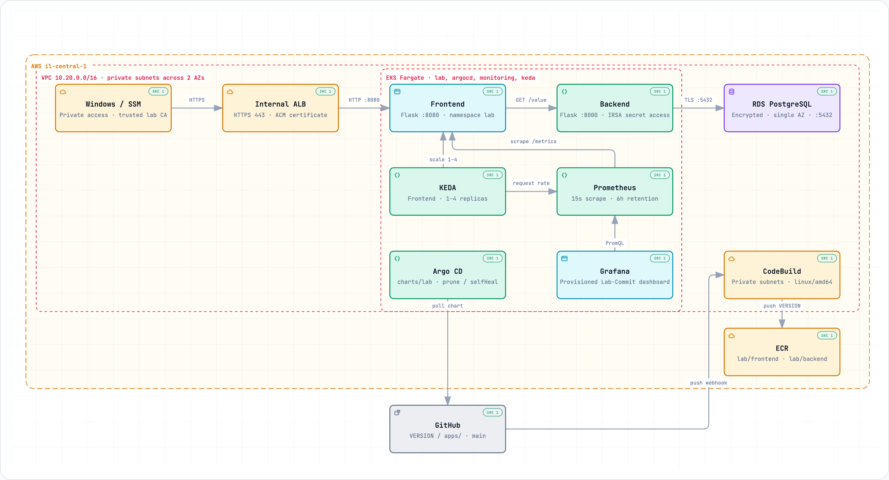

# Lab-Commit: EKS Scaling and Pipeline

Private EKS (Fargate only) platform on AWS, built with Terraform. Work is split into numbered stacks applied in order. Each stack has its own state key in one S3 bucket.

## Status

| Stack | Content | State |
|---|---|---|
| 00-bootstrap | State bucket, budget alarms | done |
| 10-network | VPC, 2 private subnets, endpoints, security groups | done |
| 20-eks | Cluster 1.36, Fargate profiles, IRSA, ECR pull-through cache | done |
| 30-platform | Load Balancer Controller, Argo CD, KEDA, Prometheus, Grafana | done |
| 40-data | RDS PostgreSQL, database secret, backend IRSA role | done |
| 50-edge | Self-signed CA and certificate in ACM, private Route53 zone, ALB records | done |
| 60-windows | Windows instance via SSM, Chrome from S3, lab CA trusted | done |
| 70-pipeline | CodePipeline with a CodeConnections source and a CodeBuild release, ECR, Argo CD app-of-apps | done |

## Architecture

<a href="https://ichcc.github.io/lab-commit/docs/architecture/">
  <picture>
    <source media="(prefers-color-scheme: dark)" srcset="docs/architecture/architecture-dark.png">
    
  </picture>
</a>

[Open the interactive architecture](https://ichcc.github.io/lab-commit/docs/architecture/): Runtime, CI/CD and Observability-Scaling views with animated connections, zoom and pan, search and source references. It is served by GitHub Pages from `docs/architecture/index.html`. See [viewer usage and evidence](docs/architecture/README.md).

Everything runs in private subnets. The only path to the application is from inside the VPC: the Windows instance resolves `*.lab.internal` in the private zone and reaches the internal ALB over HTTPS. Pods pull images from ECR and call AWS APIs through interface endpoints. The fck-nat instance gives private subnets outbound access to GitHub, Docker Hub and GHCR.

A push that changes `VERSION` or `apps/` starts the CodePipeline release through a CodeConnections trigger. The release commit changes only `charts/lab/Chart.yaml`, which the trigger file filter ignores, so no second run starts.

## Prerequisites

- AWS CLI v2, Terraform >= 1.10, kubectl, Helm 3, Docker, Git
- AWS credentials with a privileged role assumed in the console or CLI
- A new GitHub repository for this project
- A region where EKS 1.36 and Fargate are available

The lab runs in `eu-north-1` (Stockholm), the region given with the lab account. It is enabled by default, so there is nothing to opt in to.

Verify the region before anything else:

```bash
export AWS_REGION=eu-north-1
aws eks describe-addon-versions --kubernetes-version 1.36 --region "$AWS_REGION" --query 'addons[0].addonName'
aws sts get-caller-identity
```

Expected: an addon name and your account id.

## Apply order

| Order | What | Notes |
|---|---|---|
| 0 | `scripts/delete-default-vpc.sh` | Removes the default VPC in `eu-north-1`, if it still exists |
| 1 | `terraform/00-bootstrap` | Local state, creates the state bucket |
| 2 | `terraform/10-network` | |
| 3 | `terraform/20-eks` | Then `aws eks update-kubeconfig` |
| 4 | `scripts/mirror-images.sh` | KEDA, Grafana and k6 images |
| 5 | `terraform/30-platform` | |
| 6 | `terraform/40-data` | |
| 7 | Tests and chart check | Local only |
| 8 | `terraform/50-edge`, phase one | Certificate and zone |
| 9 | `terraform/60-windows` | Stage the Chrome installer first |
| 10 | GitHub repository, `terraform/70-pipeline`, first build, `scripts/render-values.sh`, `kubectl apply -f gitops/root.yaml` | Argo CD creates the ALB |
| 10a | `terraform/50-edge`, phase two | `alb_ready=true` |
| 11 | `scripts/run-loadgen.sh` | Autoscaling demo |

A full build from an empty account takes about 60 to 75 minutes, most of it EKS, RDS and the first Fargate pods.

## Step 0: remove the default VPC

```bash
./scripts/delete-default-vpc.sh "$AWS_REGION"
```

The script detaches and deletes the internet gateway, deletes the subnets, then deletes the VPC. It exits cleanly when no default VPC exists.

## Step 1: bootstrap state and budget

```bash
cd terraform/00-bootstrap
cp example.tfvars terraform.tfvars
terraform init
terraform apply
```

Edit `terraform.tfvars` first: set `region`, `budget_usd` to a value below your credit balance, and `budget_email`. Bootstrap uses local state. Keep the generated `terraform.tfstate` file or re-import the bucket if you lose it.

Note the `state_bucket` output.

## Step 2: network

```bash
cd ../10-network
cp backend.hcl.example backend.hcl
cp example.tfvars terraform.tfvars
```

Fill `backend.hcl` with the bucket name and region, then:

```bash
terraform init -backend-config=backend.hcl
terraform apply
```

Result:

- VPC `10.20.0.0/16`, DNS hostnames enabled
- 2 private subnets in 2 AZs holding every workload
- 1 small public subnet that contains only the fck-nat instance, with an internet gateway
- fck-nat (t4g.micro, ASG-backed) giving the private route table a default route for outbound traffic, so Argo CD, CodeBuild and Helm can reach GitHub
- One private route table with local routes, the S3 gateway endpoint and the NAT default route
- Interface endpoints (ECR, STS, Logs, EC2, ELB, SSM, Secrets Manager, EKS, CodeBuild, KMS) in both subnets
- Security groups: endpoints (443 from VPC), ALB (80/443 from VPC), Windows (egress only to VPC and S3, so it has no Internet access)

Nothing in the VPC is reachable from the Internet: the public subnet has no workloads, the load balancer is internal, and inbound traffic to the NAT instance is limited to the VPC CIDR.

The fck-nat module is pinned to release `v1.6.1` through `?ref=` in `nat.tf`. To upgrade, change the tag, run `terraform init -upgrade` and review the plan for NAT replacement. Provider versions are pinned by the committed `.terraform.lock.hcl` in each stack.

Interface endpoints are the largest hourly cost in this stack. With NAT in place, ECR, STS, Logs, EKS, EC2, ELB, Secrets Manager, KMS and CodeBuild endpoints are optional and can be removed from `interface_endpoints` to save money. Keep `ssm`, `ssmmessages` and `ec2messages` for the Windows instance.

## Step 3: EKS

```bash
cd ../20-eks
cp backend.hcl.example backend.hcl
cp example.tfvars terraform.tfvars
```

Fill `backend.hcl` and `terraform.tfvars`. `admin_cidrs` must contain your current public IP as `x.x.x.x/32`, because Terraform and kubectl reach the API through the public endpoint during build.

```bash
terraform init -backend-config=backend.hcl
terraform apply
aws eks update-kubeconfig --name lab-commit-eks --region "$AWS_REGION"
kubectl get pods -A
```

Result:

- Cluster `lab-commit-eks`, Kubernetes 1.36, API authentication mode `API`, creator has admin
- No node groups. One Fargate profile per namespace: `default`, `kube-system`, `argocd`, `keda`, `monitoring`, `lab`
- CoreDNS addon configured to run on Fargate
- OIDC provider for IRSA (EKS Pod Identity is not supported on Fargate)
- ECR pull-through cache rules: `ecr-public/`, `k8s/`, `quay/`. Docker Hub and GHCR need registry credentials in Secrets Manager and are not configured
- Cluster security group accepts the ALB security group on ports 80, 3000, 8000, 8080, 9090 only

Image paths for later stacks follow this pattern:

```
<account>.dkr.ecr.<region>.amazonaws.com/quay/prometheus/prometheus:<tag>
<account>.dkr.ecr.<region>.amazonaws.com/k8s/metrics-server/metrics-server:<tag>
```

The first pull of each image creates the cached repository.

CoreDNS can stay in Pending for a few minutes after the Fargate profile is created. If it does not start:

```bash
kubectl -n kube-system rollout restart deployment coredns
```

To lock the API down at the end of the lab set `public_endpoint = false` and re-apply from a host inside the VPC.

## Step 4: mirror images that the pull-through cache cannot serve

Fargate pods in private subnets pull only from ECR. The pull-through cache covers `public.ecr.aws`, `registry.k8s.io` and `quay.io` without credentials. KEDA (GHCR) and Grafana (Docker Hub) need credentials for a cache rule, so they are copied once instead:

```bash
./scripts/mirror-images.sh "$AWS_REGION"
```

Requirements: Docker with buildx, AWS CLI, and internet access from your workstation. The script logs in to ECR, creates `mirror/<name>` repositories and copies the multi-arch manifests listed in `scripts/mirror-images.txt`. Tags in that file must match `keda_image_tag` and `grafana_image_tag` in the platform stack.

## Step 5: platform

```bash
cd terraform/30-platform
cp backend.hcl.example backend.hcl
cp example.tfvars terraform.tfvars
terraform init -backend-config=backend.hcl
terraform apply
```

Terraform runs Helm from your workstation, so the EKS public endpoint must still allow your IP (`admin_cidrs` in stack 20) and `aws` must be on `PATH` for token generation. Charts download from the public Helm repositories on your machine. Images come from ECR.

Installed releases:

| Release | Namespace | Notes |
|---|---|---|
| aws-load-balancer-controller | kube-system | IRSA role, Shield/WAF disabled, VPC id and region set explicitly because Fargate has no instance metadata |
| keda | keda | Images from `mirror/kedacore/*` |
| argocd | argocd | Dex and notifications disabled, `server.insecure=true` so the ALB terminates TLS |
| prometheus | monitoring | No node-exporter, Alertmanager or Pushgateway (DaemonSets and PVCs do not fit Fargate). Retention 6h, no persistent volume. Fargate exposes no kubelet port to pods, so the `kubernetes-nodes` and `kubernetes-nodes-cadvisor` jobs are rewritten to `https://kubernetes.default.svc/api/v1/nodes/<node>/proxy/metrics[/cadvisor]`, and the extra ClusterRole `prometheus-server-nodes-proxy` grants `nodes/proxy`. Pod CPU and memory come from that cAdvisor job, replica counts from kube-state-metrics |
| grafana | monitoring | Prometheus datasource and the `Lab-Commit` dashboard are provisioned from `dashboards/lab-commit.json` |

Check:

```bash
kubectl get pods -A
kubectl -n argocd get secret argocd-initial-admin-secret -o jsonpath='{.data.password}' | base64 -d; echo
terraform output -raw grafana_admin_password; echo
```

Until the ALB ingress exists (stack 50) use port forwarding:

```bash
kubectl -n argocd port-forward svc/argocd-server 8080:80
kubectl -n monitoring port-forward svc/grafana 3000:80
```

Fargate pods take one to two minutes to start, so the first apply can take about 10 minutes. If a release times out, run `terraform apply` again.

Troubleshooting:

- The CPU and memory panels are empty: open `http://localhost:9090/targets` after `kubectl -n monitoring port-forward svc/prometheus-server 9090:80`. The `kubernetes-nodes-cadvisor` targets must be `UP` with paths like `/api/v1/nodes/fargate-ip-.../proxy/metrics/cadvisor`. A `403` means the `prometheus-server-nodes-proxy` ClusterRoleBinding is missing: `kubectl get clusterrolebinding prometheus-server-nodes-proxy`.

The dashboard panels expect the `lab` namespace, deployments named `frontend` and `backend`, and an `http_requests_total` metric exposed by the frontend with Prometheus scrape annotations.

## Step 6: data

Prerequisites: stacks 10 and 20 applied, because this stack reads their remote state (VPC, private subnets, cluster security group, OIDC provider).

```bash
cd terraform/40-data
cp backend.hcl.example backend.hcl
cp example.tfvars terraform.tfvars
terraform init -backend-config=backend.hcl
terraform plan
terraform apply
```

RDS takes about 5 to 8 minutes to create.

Result:

- RDS PostgreSQL 18, `db.t4g.micro`, 20 GB gp3, encrypted, single AZ, in a DB subnet group over the two private subnets, `publicly_accessible = false`
- Master password generated and stored by RDS in Secrets Manager (`manage_master_user_password`), never in Terraform state or tfvars
- Security group `lab-commit-db` that allows port 5432 only from the EKS cluster security group. Fargate pods use that group, so pods can connect and nothing else in the VPC can
- IAM role `lab-commit-eu-north-1-backend` for the `lab/backend` service account (IRSA), allowed only `GetSecretValue` and `DescribeSecret` on the database secret. Pods reach Secrets Manager through the `secretsmanager` interface endpoint
- No table is created here. The Helm chart runs a seed Job that creates `lab_values` and inserts the initial rows idempotently

Outputs used by the chart:

```bash
terraform output -raw db_endpoint
terraform output -raw db_secret_arn
terraform output -raw backend_role_arn
```

Check:

```bash
aws rds describe-db-instances --db-instance-identifier lab-commit-db \
  --query 'DBInstances[0].[DBInstanceStatus,PubliclyAccessible,StorageEncrypted,Engine,EngineVersion]'
aws secretsmanager describe-secret --secret-id "$(terraform output -raw db_secret_arn)" --query Name
```

Expected: `available`, `false`, `true`, `postgres`, `18.x`, and a secret name starting with `rds!db-`.

Troubleshooting:

- `Error reading remote state`: `state_bucket` or `region` in `terraform.tfvars` does not match the bucket from stack 00, or stack 10 or 20 was not applied.
- `InvalidParameterCombination` for the engine version: list the versions offered for the instance class and set `db_engine_version`:
  `aws rds describe-orderable-db-instance-options --engine postgres --db-instance-class db.t4g.micro --query 'OrderableDBInstanceOptions[].EngineVersion'`
- The backend logs `no pg_hba.conf entry ... no encryption`: PostgreSQL 18 on RDS enforces SSL (`rds.force_ssl = 1`). Keep `DB_SSLMODE=require` in the chart values.
- `AccessDeniedException` on `GetSecretValue`: the service account is missing the `eks.amazonaws.com/role-arn` annotation, or its namespace or name differs from `backend_namespace` and `backend_service_account`.

## Step 7: applications and chart

Two Flask services in `apps/`, packaged by the Helm chart `charts/lab`. Argo CD deploys the chart (stack 70 and `gitops/`). This step covers local tests and the chart values.

| Service | Port | Endpoints | Notes |
|---|---|---|---|
| backend | 8000 | `GET /value`, `GET /healthz` | Reads the database password from Secrets Manager with boto3 through IRSA, returns the next row of `lab_values` in a loop. The loop position is the sequence `lab_values_cursor`, so all replicas share it |
| frontend | 8080 | `GET /`, `GET /healthz`, `GET /livez`, `GET /metrics` | A background thread polls the backend every 5 seconds. `/` returns `Hello Lab-Commit <APP_VERSION> <value>`, with ` (stale)` appended when the last successful poll is older than `STALE_SECONDS` (30). `/healthz` is the readiness check and returns 503 until the first successful poll and whenever the value is stale; `/livez` only reports that the process is up. `http_requests_total` counts only `/`, not health checks or scrapes |

`seed.py` in the backend image creates `lab_values` and the sequence and inserts the initial rows only when the table is empty. The chart runs it as a Job.

Prerequisites: Python 3.13, `uv` or `pip`, Docker, Helm 3.

### Tests

```bash
cd apps/backend
python3.13 -m venv .venv && .venv/bin/pip install -r requirements.txt -r requirements-dev.txt
PYTHONPATH=. .venv/bin/pytest -q tests

cd ../frontend
python3.13 -m venv .venv && .venv/bin/pip install -r requirements.txt -r requirements-dev.txt
PYTHONPATH=. .venv/bin/pytest -q tests
```

Expected: `6 passed` for the backend and `5 passed` for the frontend.

### Images

Both Dockerfiles use `public.ecr.aws/docker/library/python:3.13-slim` and run as UID 10001. Fargate runs x86, so build for `linux/amd64`:

```bash
docker build --platform linux/amd64 -t lab/backend:v1.0.0 apps/backend
docker build --platform linux/amd64 -t lab/frontend:v1.0.0 apps/frontend
```

Inside AWS, pass the pull-through cache path so the build does not need Docker Hub or the internet:

```bash
--build-arg BASE_IMAGE=<account>.dkr.ecr.<region>.amazonaws.com/ecr-public/docker/library/python:3.13-slim
```

The pipeline in stack 70 builds and pushes both images to the `lab/backend` and `lab/frontend` ECR repositories with the chart `appVersion` as the tag.

### Chart

| Object | Details |
|---|---|
| Deployments `frontend`, `backend` | Non-root, read-only root filesystem, requests 250m CPU and 512Mi (one Fargate 0.25 vCPU / 1 GB slot), `/healthz` readiness probes; liveness uses `/healthz` on the backend and `/livez` on the frontend, so a backend outage takes frontend pods out of the Service without restarting them. `APP_VERSION` comes from `.Chart.AppVersion`, and so does the image tag unless `image.tag` is set |
| Services | ClusterIP only. The backend has no Ingress |
| ServiceAccounts | `backend` carries the IRSA annotation `backend.roleArn`. `frontend` has no token mounted |
| Job `seed` | Argo CD `Sync` hook in sync wave `-1`, after the `backend` ServiceAccount (wave `-2`) and before the Deployments, Services and Ingresses (wave 0). The frontend reports ready only with a value from the backend, so the table must exist before the Deployments are checked for health; a PostSync hook would wait for a healthy frontend and never run on an empty database. The Helm `post-install,post-upgrade` annotations stay for a plain `helm install`, and Argo CD ignores them because the Argo CD hook annotation is present. Uses the backend image and service account |
| Ingress `frontend` | Internal ALB, `target-type: ip`, group `lab-commit`, ports 80 and 443 with redirect to 443, ACM certificate, TLS policy `ELBSecurityPolicy-TLS13-1-2-Res-2021-06` (TLS 1.2 and 1.3 only, shared by the whole group), deregistration delay 30 s, host `lab-commit-task.<zone>` |
| Rollouts without ALB errors | The `lab` namespace carries `elbv2.k8s.aws/pod-readiness-gate-inject: enabled` (set by the Argo CD Application), so a new frontend pod counts as ready only after the ALB reports its target healthy. Frontend pods sleep 15 s in `preStop`, so the ALB stops sending requests before the process exits |
| Ingresses `argocd`, `grafana` | Same ALB group, created in the `argocd` and `monitoring` namespaces, hosts `argocd.<zone>` and `grafana.<zone>` |
| ScaledObject `frontend` | Prometheus trigger `sum(rate(http_requests_total{namespace="lab"}[1m]))`, `AverageValue` 10, 1 to 4 replicas, `cooldownPeriod` 60, scale-down stabilization 60 s and at most one pod every 30 s |

Required values, taken from Terraform outputs:

| Value | Source |
|---|---|
| `image.registry` | `terraform -chdir=terraform/20-eks output -raw ecr_registry` |
| `backend.roleArn` | `terraform -chdir=terraform/40-data output -raw backend_role_arn` |
| `db.host` | `terraform -chdir=terraform/40-data output -raw db_endpoint` |
| `db.secretArn` | `terraform -chdir=terraform/40-data output -raw db_secret_arn` |
| `ingress.certificateArn` | `terraform -chdir=terraform/50-edge output -raw certificate_arn` |
| `ingress.securityGroupId` | `terraform -chdir=terraform/10-network output -raw alb_security_group_id` |
| `zone` | private hosted zone name, default `lab.internal` |

Render and lint:

```bash
helm lint charts/lab -f my-values.yaml
helm template lab charts/lab -n lab -f my-values.yaml
```

Without the required values the render stops with a message such as `db.host is required`.

Troubleshooting:

- Pods stay `Pending`: the namespace has no Fargate profile, or the requests do not fit a Fargate size. `kubectl -n lab describe pod <pod>` shows the reason.
- `ImagePullBackOff`: the images are not pushed yet, or the tag does not match `appVersion`. `aws ecr describe-images --repository-name lab/frontend`.
- Frontend pods stay `0/1` or the page shows `(stale)`: the frontend has no fresh value from the backend. `kubectl -n lab exec deploy/frontend -- python -c "import urllib.request as u; print(u.urlopen('http://localhost:8080/healthz').read())"` fails with 503 and the frontend logs show `backend poll failed`.
- The sync stays in wave `-1` (`kubectl -n argocd get application lab -o jsonpath='{.status.operationState.message}'`): the seed Job cannot reach the database or Secrets Manager. `kubectl -n lab logs job/seed`. Argo CD retries the sync five times, then run `argocd app sync lab` or click Sync after fixing the cause.
- `helm install --wait` times out: with `--wait` Helm waits for a ready frontend before it runs the seed hook. Install without `--wait`, or use Argo CD.
- The page shows `n/a`: the backend is not ready or the seed Job has not finished. `kubectl -n lab logs deploy/backend` and `kubectl -n lab get jobs`.
- All three Ingresses in one group must carry the same scheme, certificate and security group annotations, otherwise the controller rejects the group. `kubectl -n lab describe ingress frontend` shows the error event.
- The ScaledObject is not `READY`: KEDA cannot reach Prometheus. `kubectl -n lab describe scaledobject frontend` and `kubectl -n keda logs deploy/keda-operator`. An empty query result before the first page request counts as 0 and is not an error.

## Step 8: edge (certificate and private DNS)

Prerequisites: stack 10 applied. The second phase also needs the chart synced by Argo CD, because the load balancer controller creates the ALB from the Ingresses.

The stack creates:

- A private CA (self-signed root, RSA 2048, one year) and a server certificate signed by it with SANs `lab-commit-task.<zone>`, `argocd.<zone>` and `grafana.<zone>`. A self-signed root plus a leaf is used instead of one self-signed leaf because Chrome does not accept a leaf certificate (`CA:FALSE`) as a trust anchor
- The server certificate and chain imported into ACM (`certificate_arn` output, used by the chart as `ingress.certificateArn`)
- The CA certificate in SSM Parameter Store at `/lab-commit/ca-certificate`, where the Windows instance reads it
- A private Route53 hosted zone (`zone_name`, default `lab.internal`) attached to the VPC
- After phase two, alias A records for the three hostnames pointing to the internal ALB

The private keys are generated by Terraform and live in the state file. The state bucket is encrypted and private. For anything beyond a lab, issue certificates outside Terraform.

### Phase one: certificate and zone

```bash
cd terraform/50-edge
cp backend.hcl.example backend.hcl
cp example.tfvars terraform.tfvars
terraform init -backend-config=backend.hcl
terraform apply
terraform output -raw certificate_arn
```

Keep `alb_ready = false`. Put the certificate ARN and zone name into the chart values, then let Argo CD sync (see "Pipeline and GitOps").

### Phase two: DNS records

The controller tags the shared ALB with `ingress.k8s.aws/stack = lab-commit` (the `group.name`). Wait until it exists:

```bash
aws elbv2 describe-load-balancers \
  --query "LoadBalancers[?starts_with(LoadBalancerName, 'k8s-labcommit')].[LoadBalancerName,Scheme,State.Code]"
kubectl get ingress -A
```

Expected: one load balancer, `internal`, `active`, and three Ingresses with the same address. Then:

```bash
terraform apply -var alb_ready=true
```

Or set `alb_ready = true` in `terraform.tfvars` so later applies keep the records.

### Check

```bash
aws acm describe-certificate --certificate-arn "$(terraform output -raw certificate_arn)" \
  --query 'Certificate.[Type,Status,DomainName,SubjectAlternativeNames]'
aws route53 list-resource-record-sets --hosted-zone-id "$(terraform output -raw zone_id)" \
  --query "ResourceRecordSets[?Type=='A'].[Name,AliasTarget.DNSName]"
```

Expected: `IMPORTED`, `ISSUED`, the three names, and three A records pointing to the same `internal-k8s-labcommit-...` name.

Troubleshooting:

- `no matching LB found` in phase two: the Ingresses are not reconciled yet. Check `kubectl -n lab describe ingress frontend` for controller events, for example a missing certificate ARN or a mismatch inside the group.
- `multiple LBs matched`: an older ALB with the same group tag is still being deleted. Wait and retry.
- Names do not resolve from the Windows instance: the zone must be attached to the VPC (`aws route53 get-hosted-zone --id <zone>` shows `VPCs`), and the VPC needs DNS support and DNS hostnames, which stack 10 enables.
- Destroy order: run `terraform apply -var alb_ready=false` or destroy this stack before the ALB is removed, otherwise the data source fails on the next plan.

## Step 9: Windows test instance

A Windows Server 2022 instance inside the VPC is the only client of the internal ALB. It has no public IP, no key pair and no inbound rules. Access goes through Systems Manager.

Prerequisites: stacks 10 and 50 (phase one) applied, because this stack reads the Windows security group and the CA parameter from their state. AWS CLI with the Session Manager plugin on your workstation for port forwarding.

The stack creates:

- `t3.medium` from the latest `Windows_Server-2022-English-Full-Base` AMI, in the first private subnet, security group `lab-commit-windows` from stack 10, IMDSv2 required, 50 GB encrypted gp3 root volume
- Instance profile with `AmazonSSMManagedInstanceCore`, read access to the installers bucket, and `ssm:GetParameter` on the CA certificate and the Administrator password parameters
- Private S3 bucket `lab-commit-installers-<account>-<region>` for the Chrome installer
- A random Administrator password in SSM Parameter Store (`/lab-commit/windows-admin-password`, SecureString)
- SSM document `lab-commit-windows-setup` and an association that runs it on the instance: set the Administrator password, run `scripts/trust-cert.ps1` (imports the lab CA into `LocalMachine\Root`), install Chrome from S3

Chrome comes from S3, not from the internet. The Windows security group allows only HTTPS to the VPC (SSM endpoints, ALB) and to the S3 prefix list (gateway endpoint), plus DNS and HTTP inside the VPC. There is no route to the internet for this instance, which is also what makes the "not reachable from the Internet" check meaningful.

### Stage the Chrome installer

Run once from your workstation, which has internet access:

```bash
cd terraform/60-windows
cp backend.hcl.example backend.hcl
cp example.tfvars terraform.tfvars
terraform init -backend-config=backend.hcl
terraform apply -target=aws_s3_bucket.installers
../../scripts/stage-chrome.sh "$(terraform output -raw installers_bucket)" "$AWS_REGION"
terraform apply
```

The script downloads the Chrome Enterprise 64-bit MSI from Google, checks the file signature and uploads it to `s3://<bucket>/chrome/googlechromestandaloneenterprise64.msi`.

### Check the setup

The instance needs about 5 minutes to boot and register with SSM.

```bash
INSTANCE_ID=$(terraform output -raw instance_id)
aws ssm describe-instance-information --filters Key=InstanceIds,Values="$INSTANCE_ID" \
  --query 'InstanceInformationList[0].[PingStatus,PlatformName]'
aws ssm describe-association-executions --association-id "$(terraform output -raw association_id)" \
  --query 'AssociationExecutions[0].[Status,DetailedStatus]'
aws ec2 describe-instances --instance-ids "$INSTANCE_ID" \
  --query 'Reservations[0].Instances[0].[PublicIpAddress,MetadataOptions.HttpTokens,KeyName]'
```

Expected: `Online`, `Microsoft Windows Server 2022 Datacenter`, association `Success`, and `None`, `required`, `None`.

### Connect with Fleet Manager

1. Read the password: `aws ssm get-parameter --name /lab-commit/windows-admin-password --with-decryption --query Parameter.Value --output text`
2. Console: Systems Manager, Fleet Manager, select the instance, Node actions, Connect with Remote Desktop.
3. Authentication type "User credentials", user `Administrator`, the password from step 1.

### Connect with port forwarding

```bash
aws ssm start-session --target "$INSTANCE_ID" \
  --document-name AWS-StartPortForwardingSession \
  --parameters portNumber=3389,localPortNumber=13389
```

Then connect an RDP client to `localhost:13389` as `Administrator`. Windows App on macOS or `mstsc` on Windows work.

### Browse

In Chrome on the instance:

- `https://lab-commit-task.lab.internal` shows `Hello Lab-Commit v1.0.0 <value>`, the value changes about every 5 seconds on refresh
- `https://argocd.lab.internal` opens Argo CD (user `admin`, password from `argocd-initial-admin-secret`)
- `https://grafana.lab.internal` opens Grafana (user `admin`, password from `terraform -chdir=terraform/30-platform output -raw grafana_admin_password`)

The padlock shows a valid connection: the certificate is issued by `lab-commit lab CA`, which the setup imported. `http://` redirects to `https://`.

To run the trust script again by hand, in an elevated PowerShell on the instance: `.\trust-cert.ps1` (reads the CA from SSM) or `.\trust-cert.ps1 -PemPath C:\path\ca.pem`.

### Not reachable from the Internet

From your workstation:

```bash
dig +short lab-commit-task.lab.internal
aws elbv2 describe-load-balancers --query "LoadBalancers[?starts_with(LoadBalancerName, 'k8s-labcommit')].[Scheme,DNSName]"
curl -sk --max-time 10 "https://$(aws elbv2 describe-load-balancers --query "LoadBalancers[?starts_with(LoadBalancerName, 'k8s-labcommit')].DNSName" --output text)" || echo "unreachable"
```

Expected: no answer from public DNS for the private zone, scheme `internal`, and the curl times out because the ALB DNS name resolves to private VPC addresses.

Troubleshooting:

- Instance not `Online` in SSM: the `ssm`, `ssmmessages` and `ec2messages` endpoints must exist in stack 10, and the Windows security group must allow HTTPS to the VPC. Check the instance console screenshot in EC2.
- Association `Failed` at `installChrome`: the MSI is not staged. Stage it, then `aws ssm start-associations-once --association-ids <id>`.
- Chrome shows `NET::ERR_CERT_AUTHORITY_INVALID`: the trust step did not run or the certificate was recreated. Run `trust-cert.ps1` again and restart Chrome.
- Name does not resolve: phase two of stack 50 has not been applied, or the private zone is not attached to the VPC.
- Fleet Manager says the password is wrong: the association has not finished the first step yet. Check the association execution.

Cost: about 0.07 USD per hour while running, including the Windows licence. Stop the instance between sessions: `aws ec2 stop-instances --instance-ids "$INSTANCE_ID"`.

## Step 10: pipeline and GitOps

Source of truth is the public GitHub repository `ichcc/lab-commit`. Argo CD deploys `charts/lab` from it, and a CodePipeline builds the images when the version changes.

### Design

```
git push (VERSION or apps/**)
  -> CodeConnections trigger -> CodePipeline lab-commit-release (V2, queued)
  -> Source: full clone of main through the connection
  -> Build: CodeBuild lab-commit-release (VPC, private subnets, NAT)
       build apps/backend and apps/frontend, push lab/<service>:<VERSION> to ECR
       set version and appVersion in charts/lab/Chart.yaml
       commit "Release <VERSION> [skip ci]" and push to main
  -> Argo CD (polls GitHub every 3 minutes through NAT) syncs the lab Application
  -> new pods show "Hello Lab-Commit <VERSION> <value>"
```

The pipeline reads GitHub through a CodeConnections connection, which is authorized once in the console. The source action hands CodeBuild a full clone (`CODEBUILD_CLONE_REF`), because the build compares `apps/` with the commit an existing image was built from. The connection gives read access only, so the commit-back pushes with a fine-grained token kept in Secrets Manager.

The commit-back cannot start a new run: the pipeline trigger only reacts to pushes to `main` that change `VERSION` or `apps/**`, while the commit-back touches only `charts/lab/Chart.yaml`. The `[skip ci]` marker in its message is kept for readers and other tools. ECR repositories are `IMMUTABLE`, so rebuilding the same version never overwrites an image. When an image tag already exists, the build reads the commit the image was built from (its `org.opencontainers.image.revision` label, through the ECR API) and compares `apps/<service>` with it. Without the label it falls back to the commit that last changed `VERSION`. If the code is the same it skips the image; if the code changed, the build fails with `bump VERSION to release it`, so a green build never leaves new code undeployed.

The commit-back runs on top of the current branch head, not on the commit that started the build. It fetches the branch, stops without a commit if `VERSION` there has already moved to a newer release, sets the chart version and pushes. A push rejected because the branch moved in the meantime is retried up to five times.

| Component | Where |
|---|---|
| `VERSION` | Release version, for example `v1.0.0` |
| `pipeline/buildspec.yml` | Build, push and chart bump |
| `terraform/70-pipeline` | ECR `lab/backend`, `lab/frontend`; Secrets Manager secret `lab-commit/github-token`; CodeConnections connection, CodePipeline, artifact bucket, CodeBuild project, IAM roles, log group, security group |
| `gitops/root.yaml` | App-of-apps root, applied once by hand |
| `gitops/apps/lab.yaml` | Application `lab`: `charts/lab` with `values.yaml` and `values-aws.yaml`, automated sync with prune and self-heal, `CreateNamespace=true` |
| `charts/lab/values-aws.yaml` | Account specific values, generated by `scripts/render-values.sh` from Terraform outputs |

The repository is public, so Argo CD reads it without credentials. The committed values contain the account id and resource ARNs but no secrets.

Prerequisites: stacks 10 to 60 applied (phase one of 50), a GitHub account, `gh` logged in.

### 1. Create the repository and push

```bash
gh repo create ichcc/lab-commit --public --source . --remote origin
git push -u origin main
```

### 2. GitHub token

Create a fine-grained personal access token for `ichcc/lab-commit` only, with repository permissions Contents: read and write and Metadata: read. CodeBuild uses it only to push the chart bump. When you store it, check the length printed by the command below: a fine-grained token has 93 characters, and a token pasted twice or an expired one makes every push fail with 401.

### 3. Apply the stack and store the token

```bash
cd terraform/70-pipeline
cp backend.hcl.example backend.hcl
cp example.tfvars terraform.tfvars
terraform init -backend-config=backend.hcl
terraform apply
read -rs GITHUB_TOKEN
echo "length: ${#GITHUB_TOKEN}"
aws secretsmanager put-secret-value --secret-id lab-commit/github-token \
  --secret-string "{\"Token\":\"$GITHUB_TOKEN\"}"
unset GITHUB_TOKEN
```

The apply creates the ECR repositories, the secret, the connection in state `PENDING`, the pipeline and the CodeBuild project. The pipeline starts once on creation and fails in Source, because the connection is not authorized yet. The token never passes through Terraform, so it is not in the state file.

### 4. Authorize the connection

Open Developer Tools > Settings > Connections in the console, select `lab-commit-github`, choose Update pending connection, then Install a new app on the account that owns the repository (`ichcc`) for `lab-commit` only. Authorizing the app for your user is not enough: it must appear under Installed GitHub Apps on that account, or pushes will not start the pipeline.

```bash
aws codeconnections get-connection --connection-arn "$(terraform output -raw connection_arn)" \
  --query Connection.ConnectionStatus
```

Expected: `AVAILABLE`. Run `terraform apply` once more so the `connection_status` output is current.

### 5. First run

```bash
aws codepipeline start-pipeline-execution --name lab-commit-release
aws codepipeline list-pipeline-executions --pipeline-name lab-commit-release \
  --query 'pipelineExecutionSummaries[0].[status,trigger.triggerType]'
aws logs tail /codebuild/lab-commit --follow
aws ecr describe-images --repository-name lab/frontend --query 'imageDetails[].imageTags'
```

Expected: the execution ends `Succeeded`, and both images carry the tag in `VERSION`. When the chart already has that version, no commit is pushed.

### 6. Values and Argo CD bootstrap

```bash
./scripts/render-values.sh
git add charts/lab/values-aws.yaml
git commit -m "Add AWS values for lab chart"
git push
kubectl apply -f gitops/root.yaml
kubectl -n argocd get applications -w
```

Expected: `root` and `lab` become `Synced` and `Healthy` within a few minutes. The seed Job runs first, then the Deployments start and the ALB appears. Continue with phase two of stack 50 to create the DNS records.

```bash
kubectl -n lab get pods,svc,ingress,scaledobject
kubectl -n lab logs job/seed
```

### Demo: release v1.0.1

```bash
echo v1.0.1 > VERSION
git commit -am "Bump version to v1.0.1"
git push
aws codepipeline list-pipeline-executions --pipeline-name lab-commit-release --max-items 1 \
  --query 'pipelineExecutionSummaries[0].[status,trigger.triggerType,sourceRevisions[0].revisionSummary]'
aws logs tail /codebuild/lab-commit --follow
git pull
git log -1 --format='%an %s'
kubectl -n lab rollout status deploy/frontend
```

Expected: the build pushes `lab/backend:v1.0.1` and `lab/frontend:v1.0.1`, then commits `Release v1.0.1 [skip ci]` as `Lab-Commit Pipeline`. Argo CD picks it up within 3 minutes (or click Refresh in the UI), and `https://lab-commit-task.lab.internal` on the Windows instance shows `Hello Lab-Commit v1.0.1 <value>`. Exactly one execution with trigger `WebhookV2` appears for the bump; the release commit starts none.

Verified on 2026-10-25 with `v1.0.3`: the push started execution `86bef578` with trigger `WebhookV2`, the build pushed both images and the commit `Release v1.0.3 [skip ci]`, no second execution started, and Argo CD rolled out `lab/frontend:v1.0.3` within 4 minutes. Use the next free version when you repeat the demo; the build refuses to rebuild an existing tag from changed code.

Troubleshooting:

- A push does not start the pipeline although Source works when started by hand: the AWS Connector for GitHub app is authorized for your user but not installed on the account that owns the repository. A public repository can be cloned through any installation, but push events reach only an installation on the owner. Check the Installed GitHub Apps tab (not Authorized GitHub Apps) at https://github.com/settings/installations. An `AVAILABLE` connection cannot switch installations, so replace it with `terraform apply -replace=aws_codestarconnections_connection.github`, install the app on the owner account first (https://github.com/apps/aws-connector-for-github/installations/new, only `lab-commit`), then pick that installation when you authorize the new connection.
- Source fails with `The connection is not available` or `Unable to use Connection`: the connection is still `PENDING`, or the GitHub app is not installed on the repository. Authorize it (step 4) and choose Release change.
- A push does not start the pipeline: it did not change `VERSION` or `apps/**`, or it went to another branch. Check `aws codepipeline get-pipeline --name lab-commit-release --query pipeline.triggers`.
- Build fails at `docker login` or `docker pull`: the CodeBuild security group must allow egress, and the private subnets need the NAT route from stack 10.
- Build fails with `apps/frontend changed after ...:v1.0.1 was built from <commit>, bump VERSION to release it`: a change under `apps/` was pushed without a new `VERSION`. Bump `VERSION` and push.
- Build log shows `release of v1.0.1 is superseded`: a newer `VERSION` reached the branch during the build, and its own build will update the chart.
- Build fails with `could not push the release commit`: the branch kept moving for five attempts. Run the pipeline again with `aws codepipeline start-pipeline-execution --name lab-commit-release`.
- Build fails at `git push` with 401 or 403: the stored token is wrong or expired (401), or it lacks Contents write, or branch protection blocks it (403). Check the length of the stored token and test it with `curl -H "Authorization: Bearer <token>" https://api.github.com/repos/ichcc/lab-commit`.
- Argo CD shows `values-aws.yaml: no such file`: run `scripts/render-values.sh`, commit and push.
- Argo CD shows `ComparisonError` with `required`: a value in `values-aws.yaml` is empty because a Terraform output was missing when the script ran.
- The page still shows the old version: check `kubectl -n argocd get application lab -o jsonpath='{.status.sync.revision}'` against `git rev-parse HEAD`, and that the image tag exists in ECR.

## Step 11: load test and autoscaling

A k6 Job inside the cluster sends HTTPS requests to `https://lab-commit-task.<zone>/` through the internal ALB, the same path the Windows browser uses. KEDA scales the frontend from the request rate.

Prerequisites: the application synced and reachable (steps 8 and 10), the k6 image mirrored, `kubectl` pointed at the cluster.

### Mirror the k6 image

k6 is on Docker Hub, which the pull-through cache does not serve. `scripts/mirror-images.txt` lists `docker.io/grafana/k6:2.3.0`, so run the mirror script again if you ran it before this line existed:

```bash
./scripts/mirror-images.sh "$AWS_REGION"
aws ecr describe-images --repository-name mirror/grafana/k6 --query 'imageDetails[].imageTags'
```

### Run

```bash
./scripts/run-loadgen.sh "$AWS_REGION" lab.internal
```

The script loads `loadgen/script.js` into the ConfigMap `k6-script`, deletes a previous `k6-load` Job and starts a new one in the `lab` namespace (Fargate, 1 vCPU, 2 GB). The profile:

| Phase | Duration | Requests per second |
|---|---|---|
| Ramp up | 2 min | 1 to 40 |
| Hold | 6 min | 40 |
| Ramp down | 1 min | 40 to 0 |

TLS verification is skipped (`insecureSkipTLSVerify`) because the pod does not trust the lab CA. Override the target or rate by editing `TARGET_URL` and `TARGET_RPS` in `loadgen/job.yaml`, or the stage lengths with `RAMP_UP`, `HOLD`, `RAMP_DOWN`.

### How scaling works

KEDA polls Prometheus every 15 seconds with `sum(rate(http_requests_total{namespace="lab"}[1m]))` and feeds the HPA an `AverageValue` target of 10 requests per second per pod. At 40 requests per second the HPA wants 4 pods, which is also `maxReplicaCount`.

Scale-down from 4 to 1 is driven by the HPA behavior in the ScaledObject: a 60 second stabilization window and at most one pod removed every 30 seconds. `cooldownPeriod: 60` is set as the task asks, but KEDA applies it only when scaling to zero, and `minReplicaCount` is 1.

Expected timeline:

| Time from start | Frontend pods |
|---|---|
| 0 to 1 min | 1 |
| 1 to 3 min | 2, 3, then 4 (new Fargate pods need 40 to 90 seconds to become Ready) |
| 3 to 8 min | 4 |
| 9 to 10 min | rate window drains |
| about 10 to 13 min | 3, 2, then 1 |

### Watch

```bash
kubectl -n lab get pods -l app.kubernetes.io/name=frontend -w
kubectl -n lab get hpa -w
kubectl -n lab get scaledobject frontend
kubectl -n lab logs -f job/k6-load
```

In Grafana (`https://grafana.lab.internal` from the Windows instance, or `kubectl -n monitoring port-forward svc/grafana 3000:80`), open the `Lab-Commit` dashboard: the request rate panel climbs to about 40 per second, the frontend replica panel steps from 1 to 4 and back, and the CPU and memory panels show one line per pod.

At the end k6 prints a summary. Expected: `http_req_failed` below 5 percent and both checks above 95 percent. A few failures during scale-up are normal while new pods register with the ALB.

### Measured runs

| Run | Requests | Failed | p95 | Scale up | Back to 1 pod |
|---|---|---|---|---|---|
| 2026-10-23, `il-central-1` | 18 060 | 0 | 3.95 ms | 1 to 4 in 4 min | by 12:54 |
| 2026-10-25, `eu-north-1`, release `v1.0.3` rolled out during the ramp | 18 030 | 111 (0.61 %) | 3.67 ms | 1 to 4 in 2.5 min | 13:38, about 1.5 min after k6 finished |

All 111 failures in the second run came from the ALB (`HTTPCode_ELB_504_Count` 80, `HTTPCode_ELB_502_Count` 31) in the two minutes after the `v1.0.3` ReplicaSet was created, and none from the pods (`HTTPCode_Target_5XX_Count` stayed empty). The ALB kept sending requests to frontend pods that were already stopping. The readiness gates, the `preStop` sleep and the shorter deregistration delay in the chart address this; check the ALB metrics for the test window:

```bash
LB="$(aws elbv2 describe-load-balancers --query 'LoadBalancers[?starts_with(LoadBalancerName,`k8s-labcommit`)].LoadBalancerArn' --output text | sed 's|.*:loadbalancer/||')"
aws cloudwatch get-metric-statistics --namespace AWS/ApplicationELB --metric-name HTTPCode_ELB_5XX_Count \
  --dimensions Name=LoadBalancer,Value="$LB" --start-time <start> --end-time <end> --period 60 --statistics Sum
```

Troubleshooting:

- Job pod `ImagePullBackOff`: the k6 image is not mirrored. Run the mirror script.
- k6 reports `lookup lab-commit-task.lab.internal: no such host`: phase two of stack 50 (DNS records) is not applied.
- Requests time out: the ALB security group must allow 443 from the VPC CIDR, which stack 10 configures.
- Pods do not go above 1: `kubectl -n lab describe hpa` shows the metric value. If it stays at 0, Prometheus is not scraping the frontend: check the `prometheus.io/*` annotations on the pods and the `kubernetes-pods` target in Prometheus.
- Pods stay `Pending` during scale-up: Fargate capacity is provisioning. Wait, or check events with `kubectl -n lab get events --sort-by=.lastTimestamp`.

## Verification checklist

Run from the workstation unless the line says Windows. `export AWS_REGION=eu-north-1` first.

| Check | Command | Expected |
|---|---|---|
| Unreachable from the Internet | `aws elbv2 describe-load-balancers --query "LoadBalancers[?starts_with(LoadBalancerName, 'k8s-labcommit')].Scheme"` and `curl -sk --max-time 10 https://<alb-dns-name>` | `internal`; curl times out |
| Reachable over HTTPS from Windows | Chrome on Windows: `https://lab-commit-task.lab.internal` | `Hello Lab-Commit v1.0.0 <value>`, padlock without warning |
| HTTP redirects to HTTPS | Windows PowerShell: `(Invoke-WebRequest http://lab-commit-task.lab.internal -MaximumRedirection 0 -ErrorAction SilentlyContinue).StatusCode` | `301` |
| Certificate is the imported one | `aws acm describe-certificate --certificate-arn "$(terraform -chdir=terraform/50-edge output -raw certificate_arn)" --query 'Certificate.[Type,InUseBy]'` | `IMPORTED`, in use by the ALB |
| Certificate served by the ALB | Windows PowerShell: `$t = [Net.Sockets.TcpClient]::new('lab-commit-task.lab.internal', 443); $s = [Net.Security.SslStream]::new($t.GetStream()); $s.AuthenticateAsClient('lab-commit-task.lab.internal'); $s.RemoteCertificate.Issuer` | `O=lab-commit, CN=lab-commit lab CA` |
| Value changes every 5 seconds | Windows PowerShell: `1..6 \| % { (Invoke-WebRequest https://lab-commit-task.lab.internal).Content; Start-Sleep 5 }` | a different value on most lines |
| Database is private | `aws rds describe-db-instances --db-instance-identifier lab-commit-db --query 'DBInstances[0].[PubliclyAccessible,DBSubnetGroup.Subnets[].SubnetIdentifier]'` | `false`, the two private subnets |
| Only pods can connect | `aws ec2 describe-security-group-rules --filters Name=group-id,Values="$(terraform -chdir=terraform/40-data output -raw db_security_group_id)" --query 'SecurityGroupRules[?!IsEgress].[FromPort,ReferencedGroupInfo.GroupId]'` | `5432` from the cluster security group only |
| Only the backend reads the secret | `aws iam get-role --role-name lab-commit-eu-north-1-backend --query 'Role.AssumeRolePolicyDocument.Statement[0].Condition'` | `system:serviceaccount:lab:backend` |
| No node groups | `aws eks list-nodegroups --cluster-name lab-commit-eks` | `"nodegroups": []` |
| Fargate only | `kubectl get nodes -o wide` | every node name starts with `fargate-` |
| Cluster version | `aws eks describe-cluster --name lab-commit-eks --query cluster.version` | `"1.36"` |
| Monitoring | Grafana dashboard `Lab-Commit` | CPU, memory and pod count panels for `frontend` and `backend` |
| Autoscaling | `./scripts/run-loadgen.sh "$AWS_REGION"` and `kubectl -n lab get pods -l app.kubernetes.io/name=frontend -w` | 1 to 4 pods during the hold, back to 1 a few minutes after the ramp down |
| Pipeline | release `v1.0.1` as in step 10 | `Hello Lab-Commit v1.0.1 <value>` |

## Teardown

```bash
./scripts/destroy.sh "$AWS_REGION"
```

The script writes a temporary kubeconfig for the cluster `lab-commit-eks` in the given region, so the current `kubectl` context does not matter and no other cluster is touched.

The script asks for the exact phrase `destroy lab-commit`, then:

1. Deletes the Argo CD `root` and `lab` Applications. Their finalizers remove the chart resources, so Argo CD cannot recreate the Ingresses.
2. Deletes only the Ingresses with the annotation `alb.ingress.kubernetes.io/group.name: lab-commit` and waits until no load balancer named `k8s-labcommit*` is left. Without this step the ALB, its ENIs and its security group rules block the VPC destroy.
3. Runs `terraform destroy` in `70-pipeline`, `60-windows`, `50-edge` (with `alb_ready=false`), `40-data`, `30-platform`, `20-eks`, `10-network`.
4. Deletes the ECR repositories created by this project: repositories under the prefixes of the pull-through cache rules found in the `20-eks` state (`ecr-public/`, `k8s/`, `quay/`), collected before that stack is destroyed, and the `mirror/` repositories named in `scripts/mirror-images.txt`.

The state bucket and budget in `00-bootstrap` stay, so the next session starts quickly. Add `--with-bootstrap` to remove them too. Revoke the GitHub token and uninstall the AWS Connector for GitHub app if the lab is over.

Troubleshooting:

- `kubectl get ingress` fails with a timeout: the API endpoint allows only `admin_cidrs` from stack 20, and your current IP is not in it. Update `admin_cidrs`, apply stack 20 and run the script again.
- `load balancers still exist`: an Ingress outside the `lab-commit` group, or one with a stuck finalizer, still owns the ALB. `kubectl get ingress -A` and `kubectl -n kube-system logs deploy/aws-load-balancer-controller`.
- A stack fails halfway: fix the cause and run the script again. Finished stacks have empty state and are skipped quickly. If `20-eks` was already destroyed in an earlier run, the cache rules are gone from its state and the script cannot attribute the cache repositories any more: list them with `aws ecr describe-repositories --query 'repositories[].repositoryName'` and delete the `ecr-public/`, `k8s/` and `quay/` ones by hand after checking that nobody else uses them.

## Costs

On-demand prices, October 2026, rounded. They were measured in `il-central-1`, which is priced above `eu-north-1`, so treat them as an upper estimate and recheck them before relying on them:

| Item | Hourly | 30 days |
|---|---|---|
| EKS control plane | 0.100 | 73 |
| Interface endpoints, 13 services in 2 AZs (26 x 0.01155) | 0.300 | 219 |
| Fargate, about 16 pods of 0.25 vCPU / 1 GB plus Prometheus at 0.5 vCPU / 2 GB | 0.32 | 233 |
| Windows `t3.medium` | 0.066 | 48 |
| ALB (plus LCUs) | 0.026 | 19 |
| RDS `db.t4g.micro` and 20 GB gp3 | 0.021 | 15 |
| fck-nat `t4g.micro` | 0.010 | 7 |
| **Total** | **about 0.84** | **about 615** |

Ways to keep it low:

- Destroy everything after each session with `scripts/destroy.sh`. A full rebuild takes about 60 minutes.
- Stop the Windows instance when not browsing.
- The endpoints are the largest fixed cost. With NAT in place only `ssm`, `ssmmessages` and `ec2messages` are required (the Windows instance has no NAT access). Setting `interface_endpoints` to those three in stack 10 brings that line down to about 50 per month.
- The budget alarm from stack 00 emails at the thresholds set there.
